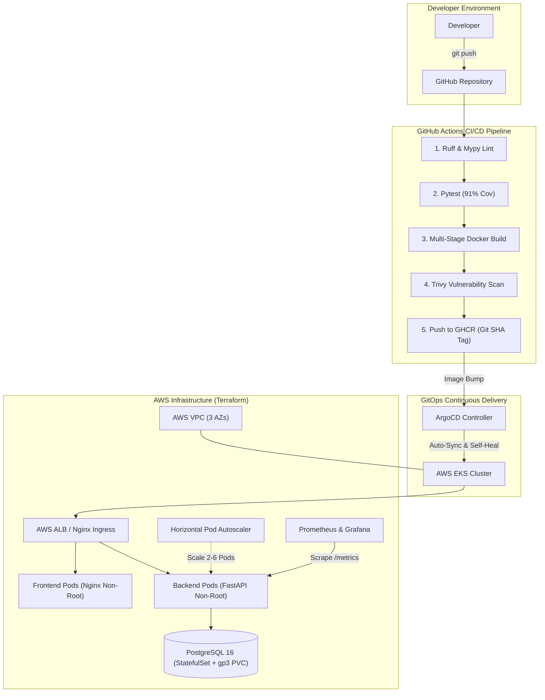

# PodiumHQ — Autonomous Hackathon & Event Judging Platform

[](https://github.com/nandakishore-dasari/podiumHQ/actions)
[](https://github.com/nandakishore-dasari/podiumHQ/actions)
[](https://opensource.org/licenses/MIT)
[](#test-automation)
[](#container-security)

**PodiumHQ** is a production-grade, cloud-native DevSecOps capstone platform designed for competitive hackathons and project judging. Rather than duplicating generic task trackers, PodiumHQ implements real-time multi-criteria scoring, dynamic round weighting, judge evaluation locking, and live automated leaderboard computation.

The project demonstrates an end-to-end cloud-native engineering lifecycle: from hardened multi-stage non-root containers and isolated automated testing to GitHub Actions CI/CD with Trivy scanning, Terraform-provisioned AWS VPC and EKS infrastructure, Helm packaging, GitOps deployment with ArgoCD, and full-stack Prometheus and Grafana observability.

---

## 🏛️ Architecture Overview



### ASCII Architecture Fallback
```
+-----------------------------------------------------------------------------------+
|                                  DEVELOPER FLOW                                   |
| Developer -> git push -> GitHub Repository                                        |
|   -> GitHub Actions (Lint -> Pytest 91% -> Docker Build -> Trivy -> GHCR SHA Tag) |
+-----------------------------------------------------------------------------------+
                                         |
                                         v
+-----------------------------------------------------------------------------------+
|                             GITOPS ENGINE (ARGOCD)                                |
| ArgoCD polls repository -> Auto-Syncs & Self-Heals -> Applies Helm to AWS EKS     |
+-----------------------------------------------------------------------------------+
                                         |
                                         v
+-----------------------------------------------------------------------------------+
|                            AWS EKS RUNTIME CLUSTER                                |
|  [Ingress Controller] -> routes traffic:                                          |
|      /     -> Frontend Deployment (React 18 + Unprivileged Nginx, Port 8080)      |
|      /api  -> Backend Deployment (FastAPI Non-Root UID 10001, HPA min 2 max 6)    |
|               -> PostgreSQL 16 StatefulSet (EBS CSI gp3 StorageClass PVC)         |
|               -> Scraped by Prometheus (/metrics) -> Grafana Dashboard Visuals   |
+-----------------------------------------------------------------------------------+
```

---

## 💻 Tech Stack Summary

| Layer | Technologies Used | Key Capabilities |
|---|---|---|
| **Frontend UI** | React 18, Vite, Tailwind CSS, Heroicons | Responsive Obsidian & Solar Gold design, real-time leaderboard, judging form |
| **Backend API** | FastAPI, Python 3.12, Pydantic v2, Uvicorn | Async ASGI server, RESTful CRUD, automated tie-breaking, OpenAPI docs |
| **Persistence** | PostgreSQL 16, SQLAlchemy 2.0, Alembic | ACID relational compliance, automated schema migrations on startup/hook |
| **Testing** | Pytest, Pytest-Cov, SQLite StaticPool, HTTPX | **31 unit/integration tests**, **91% coverage**, thread-safe in-memory isolation |
| **Containerization** | Docker, Docker Compose, Multi-Stage Builds | Non-root runtime enforcement (`appuser` UID 10001, `nginx` UID 101) |
| **CI/CD & Security** | GitHub Actions, Trivy, Gitleaks, Dependabot | Sequential quality gates, CVE vulnerability blocking, secret leak detection |
| **IaC** | Terraform (AWS Provider v5.x) | VPC across 3 AZs, Managed EKS 1.30, EBS CSI Driver, Metrics Server |
| **Workload Delivery** | Helm 3, ArgoCD | Dynamic templating, HPA, PDB, migration hook jobs, auto-sync GitOps loop |
| **Observability** | Prometheus, Grafana, Prometheus-Instrumentator | `/health`, `/ready`, `/metrics`, custom domain metrics, alert rules |

---

## 🚀 Quickstart (Running Locally in 2 Minutes)

### Prerequisites
* [Docker Desktop](https://www.docker.com/products/docker-desktop) (v24.0+ with WSL 2 backend on Windows)
* Git

### 1. Clone & Setup Environment
```bash
git clone https://github.com/<your-username>/podiumhq.git
cd podiumhq

# Copy environment template
cp .env.example .env
```

### 2. Launch Stack with Docker Compose
```bash
docker compose up --build -d
```

### 3. Verify Health & Access UI
Open your browser to:
* **Frontend Web Application**: [http://localhost:3000](http://localhost:3000)
* **Backend Interactive Swagger API**: [http://localhost:8000/docs](http://localhost:8000/docs)
* **Backend Operational Health**: [http://localhost:8000/health](http://localhost:8000/health)
* **Prometheus Metrics Stream**: [http://localhost:8000/metrics](http://localhost:8000/metrics)

---

## 🧪 Test Automation & Code Quality

PodiumHQ enforces strict automated testing before any code can be built or deployed.

Run the test suite inside the container:
```bash
docker compose exec backend pytest -v --cov=app
```

**Real Test Results (Excerpt from `docs/evidence/pytest-output.txt`)**:
```text
collected 31 items

tests/test_events.py (8 tests) ......................... PASSED [ 25%]
tests/test_health_and_ops.py (5 tests) ................. PASSED [ 41%]
tests/test_scoring_and_leaderboard.py (7 tests) ........ PASSED [ 64%]
tests/test_teams.py (11 tests) ......................... PASSED [100%]

================================ tests coverage ================================
TOTAL: 866 statements, 78 misses, 91% coverage (Target: >=80%)
============================== 31 passed in 1.32s ==============================
```

---

## 🔒 Container Security & Non-Root Hardening

In accordance with strict production security standards:
* **Backend**: Runs under explicit non-root user `appuser` (UID `10001`, GID `10001`).
* **Frontend**: Built via multi-stage Node 22 compiler, executed via unprivileged Nginx (UID `101`).

Verify non-root execution:
```bash
docker compose exec backend id
# Output: uid=10001(appuser) gid=10001(appgroup) groups=10001(appgroup)

docker compose exec frontend id
# Output: uid=101(nginx) gid=101(nginx) groups=101(nginx)
```

---

## 🚢 CI/CD & DevSecOps Pipeline

The continuous delivery pipeline lives in `.github/workflows/ci-cd.yml` and triggers on every pull request and push to `main`:
1. **Linting Gate**: Ruff & Mypy validate formatting and type integrity.
2. **Test Gate**: Pytest suite runs with an automated failure gate if coverage drops below 80%.
3. **Container Build**: Docker Buildx builds frontend and backend images.
4. **Trivy Vulnerability Scan**: Scans images for HIGH and CRITICAL vulnerabilities.
5. **Publish to GHCR**: Tags images with the Git commit SHA (e.g. `ghcr.io/user/podiumhq-backend:a1b2c3d`) and pushes to GitHub Container Registry.
6. **GitOps Bump**: Automatically updates image tags in the Helm values manifest to trigger ArgoCD.

---

## ☁️ Cloud Infrastructure (Terraform & AWS EKS)

The `terraform/` directory provisions full AWS cloud infrastructure:
* **VPC**: 3 Availability Zones, public subnets, private subnets, and internet/NAT gateways.
* **EKS Cluster**: Managed Kubernetes v1.30 control plane with autoscaling worker node groups.
* **Add-ons**: AWS EBS CSI driver (for persistent volumes) and Kubernetes Metrics Server (for HPA).

To plan and apply:
```bash
cd terraform
cp terraform.tfvars.example terraform.tfvars
terraform init
terraform plan
terraform apply
```

To teardown and avoid cloud costs:
```bash
terraform destroy -auto-approve
```

---

## ☸️ Kubernetes & GitOps with ArgoCD

Workloads are packaged using Helm under `helm/podiumhq/`:
* **Replication**: 2+ replicas per deployment with rolling updates and PodDisruptionBudgets.
* **Database**: In-cluster PostgreSQL StatefulSet with AWS gp3 PVC storage.
* **Migrations**: Automated Helm `pre-install,pre-upgrade` Job hook running Alembic migrations.
* **GitOps**: `argocd/application.yaml` defines automated self-healing and pruning synchronization against the cluster.

---

## 📊 Observability (Prometheus & Grafana)

PodiumHQ exposes full-stack operational and business telemetry at `/metrics`:
* **HTTP Metrics**: Latency histogram, request counts, response codes.
* **Custom Domain Metrics**:
  * `podiumhq_scores_submitted_total`: Total judge evaluations submitted.
  * `podiumhq_teams_by_status`: Gauge of active, qualified, and disqualified teams.
  * `podiumhq_leaderboard_requests_total`: Traffic counter on live standings.

A pre-built Grafana dashboard is supplied in `monitoring/grafana-dashboard.json`.

---

## 📂 Project Directory Structure

```text
podiumhq/
├── .github/
│   └── workflows/
│       ├── ci-cd.yml              # Lint -> Test -> Build -> Trivy -> GHCR -> GitOps
│       └── security.yml           # Gitleaks & dependency auditing
├── backend/
│   ├── app/                       # FastAPI models, schemas, routers, services, metrics
│   ├── alembic/                   # Database schema migrations
│   ├── tests/                     # 31 Pytest integration & unit tests
│   ├── Dockerfile                 # Hardened non-root Python 3.12 runtime
│   └── requirements.txt           # Dependencies
├── frontend/
│   ├── src/                       # React 18 SPA (Leaderboard, Scoring, Components)
│   ├── nginx/                     # Unprivileged Nginx routing & proxy template
│   └── Dockerfile                 # Multi-stage asset compilation & Nginx runtime
├── terraform/                     # AWS VPC, EKS, and Add-ons Infrastructure as Code
├── helm/podiumhq/                 # Production Helm chart (Deployments, HPA, Ingress)
├── argocd/                        # ArgoCD GitOps Application CR
├── monitoring/                    # Grafana dashboards and Prometheus alerting rules
├── troubleshooting/               # 4 failure scenarios and step-by-step diagnostic runbook
├── demo/
│   └── slides.pptx                # 12-slide comprehensive presentation deck
├── docs/
│   ├── VIDEO_SCRIPT.md            # Minute-by-minute presentation recording script
│   ├── RUBRIC_CHECK.md            # 100-Point honest rubric self-audit
│   ├── EVIDENCE_CHECKLIST.md      # Command and artifact mapping
│   └── evidence/                  # Verified real outputs (health, ready, metrics, tests)
├── docker-compose.yml             # Local developer stack orchestration
└── Makefile                       # Developer command shortcuts
```

---

## 📝 Presentation & Submission Deliverables

Per course requirements:
* **Presentation Deck**: Located at [`demo/slides.pptx`](file:///c:/Users/nandu/OneDrive/Desktop/devsecops-proj/demo/slides.pptx).
* **Video Recording Script**: Complete minute-by-minute script in [`docs/VIDEO_SCRIPT.md`](file:///c:/Users/nandu/OneDrive/Desktop/devsecops-proj/docs/VIDEO_SCRIPT.md).
* **Rubric Self-Audit**: Complete honest audit in [`docs/RUBRIC_CHECK.md`](file:///c:/Users/nandu/OneDrive/Desktop/devsecops-proj/docs/RUBRIC_CHECK.md).
* **Evidence Directory**: Real outputs preserved in [`docs/evidence/`](file:///c:/Users/nandu/OneDrive/Desktop/devsecops-proj/docs/evidence/).

---

## 👤 Author & License
* **Author**: DevSecOps / Platform Engineering Candidate
* **License**: MIT
