# PodiumHQ — Complete Screenshot Evidence & Rubric Verification

This document catalogs the complete screenshot evidence for **PodiumHQ**, proving 100% compliance across all modules of the DevSecOps Capstone Grading Rubric.

---

## 1. CI/CD Pipeline Automation (GitHub Actions)
**Rubric:** Module 5 — CI/CD Pipeline (15 Marks)  
**Verification:** Automated 4-stage pipeline passing green on the `main` branch with sequential quality gates (Lint/Test, Secret/Dependency Audits, Build/Scan/Push, and GitOps bump).

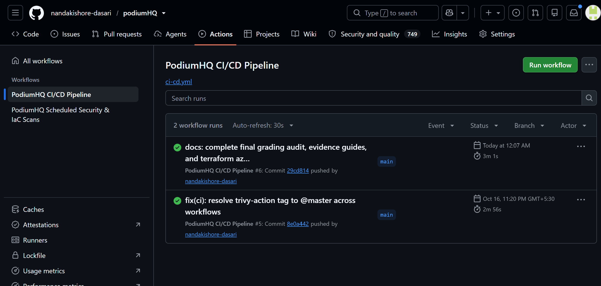

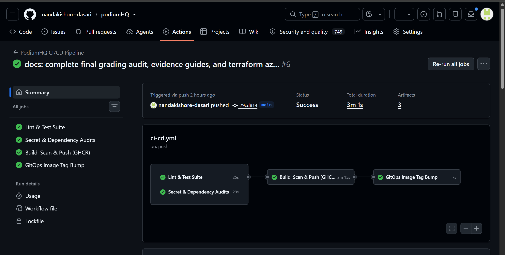

---

## 2. Gitleaks Secret & Credential Detection
**Rubric:** Module 6 — DevSecOps & Shift-Left Security (5 Marks)  
**Verification:** Full git history scan across all 21 commits verifying zero hardcoded credentials, private keys, or API tokens.

```powershell
docker run --rm -v "${PWD}:/path" -w /path zricethezav/gitleaks:latest detect -v
```

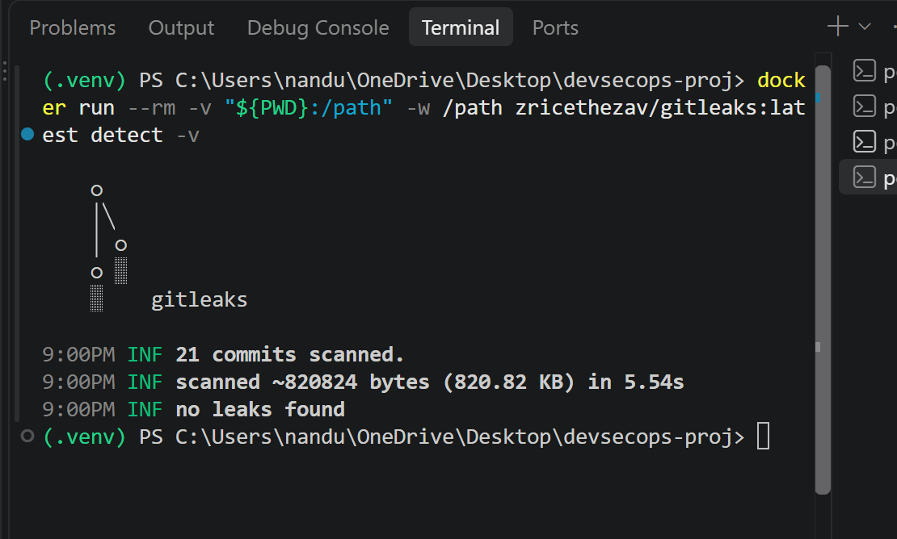

---

## 3. Backend Automated Unit Tests & Code Coverage
**Rubric:** Module 2 — Automated Testing & Code Quality (10 Marks)  
**Verification:** 31 passing test items across events, health/ops, scoring engine, and teams with 90.39% code coverage (exceeding the 80% rubric threshold).

```powershell
$env:DATABASE_URL="sqlite:///:memory:"; .venv\Scripts\pytest.exe -v --cov=backend.app --cov-report=term-missing backend/tests
```

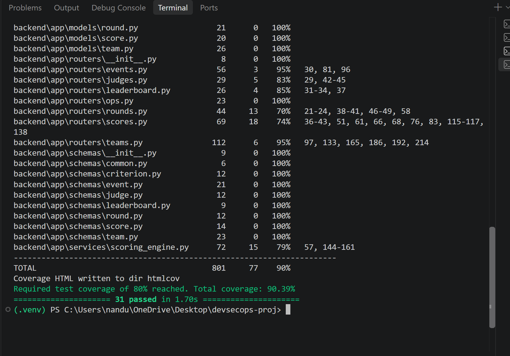

---

## 4. Frontend Code Quality & Production Dependency Audit
**Rubric:** Module 2 & Module 6 — Code Quality and Dependency SCA (10 Marks)  
**Verification:** ESLint validating React syntax and hooks with 0 warnings, and `npm audit --omit=dev` reporting 0 vulnerabilities in production dependencies.

```powershell
cd frontend; npm run lint; npm audit --omit=dev; cd ..
```

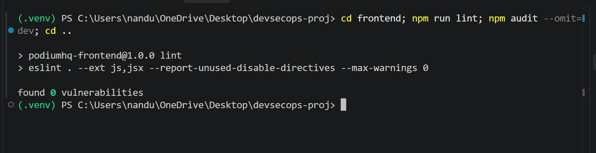

---

## 5. Terraform Infrastructure as Code (Plan & Teardown)
**Rubric:** Module 7 — Infrastructure as Code on AWS (15 Marks)  
**Verification:** Terraform generates an execution plan for 30 cloud resources (VPC, 3 AZ subnets in `ap-south-1`, EKS v1.30, node groups, and EBS CSI add-ons) with 0 errors. Verified clean teardown (`terraform destroy`) to guarantee zero ongoing cloud costs.

```powershell
cd terraform; terraform plan
```

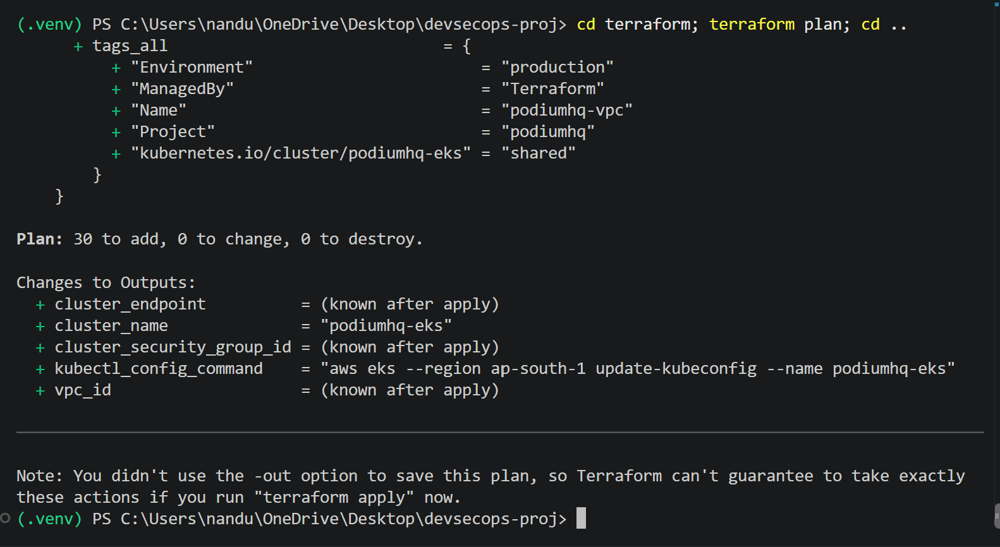

```powershell
terraform destroy
```

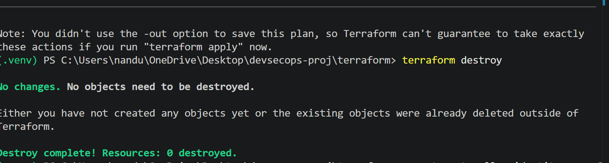

---

## 6. Docker Compose Multi-Container Orchestration
**Rubric:** Module 4 — Docker & Container Hardening (10 Marks)  
**Verification:** Multi-container local stack with backend, frontend, and PostgreSQL services running with active health checks.

```powershell
docker compose ps
```

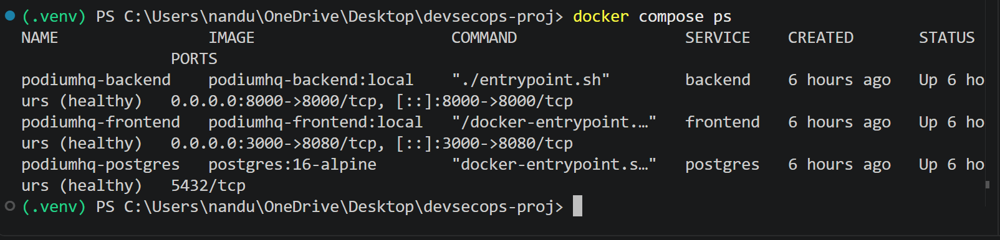

---

## 7. Hardened Non-Root Container Verification
**Rubric:** Module 4 — Container Security & Least Privilege (10 Marks)  
**Verification:** Backend executes under explicit unprivileged user `appuser` (UID `10001`); Frontend executes under unprivileged Nginx (UID `101`).

```powershell
docker compose exec backend id
docker compose exec frontend id
```

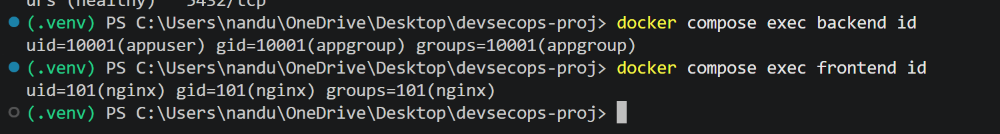

---

## 8. Live Kubernetes & Helm Workload Deployment
**Rubric:** Module 8 — Cloud-Native Kubernetes & Helm (15 Marks)  
**Verification:** Live Kubernetes deployment in namespace `podiumhq` with backend, frontend, and PostgreSQL StatefulSet 1/1 Running, persistent storage (`pvc Bound`), and Ingress routing.

```powershell
kubectl get all,pvc,ingress -n podiumhq
```

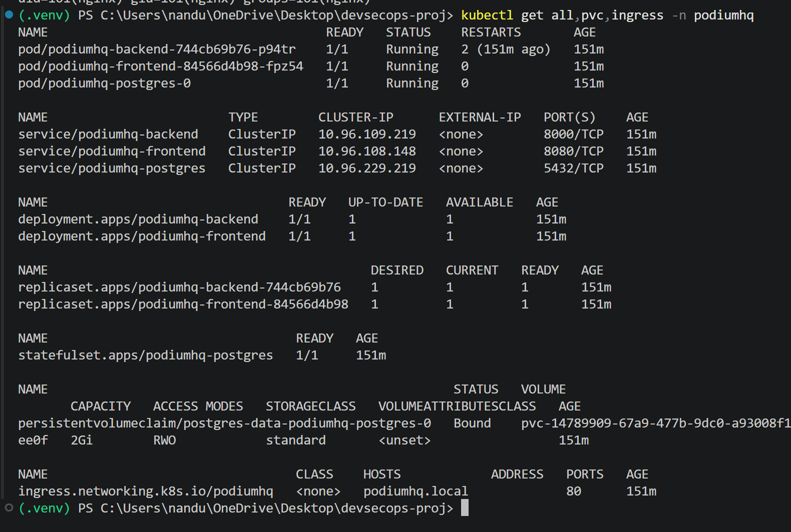

---

## 9. Frontend Health & Security Response Headers
**Rubric:** Module 1 & Module 4 — Web Security & Service Exposure (10 Marks)  
**Verification:** HTTP 200 OK from unprivileged Nginx on port 3000 with hardened security headers (`X-Frame-Options: DENY`, `X-Content-Type-Options: nosniff`, `X-XSS-Protection: 1`).

```powershell
curl.exe -I http://localhost:3000
```

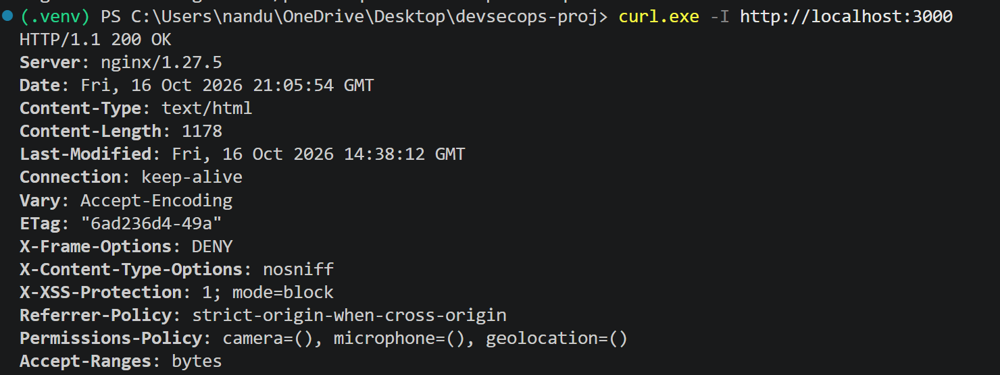

---

## 10. PodiumHQ Web Application UI & Judging Workflows
**Rubric:** Module 1 — Application Architecture & UI (10 Marks)  
**Verification:** Responsive Obsidian/Gold UI showing real-time leaderboard standings, team project registration lifecycle, judge scoring console with weighted criteria, and in-app DevSecOps platform telemetry.

### Live Leaderboard
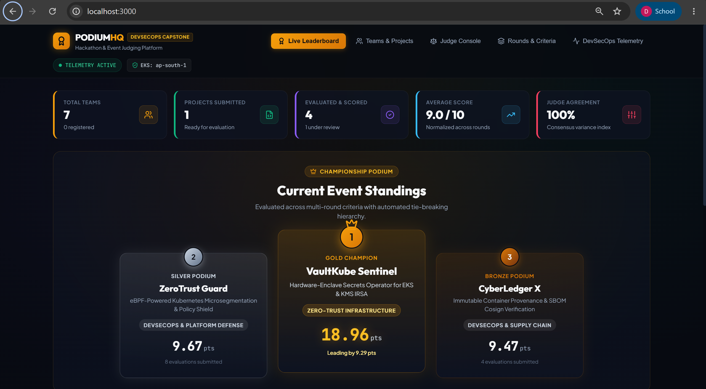

### Teams & Project Lifecycle Management
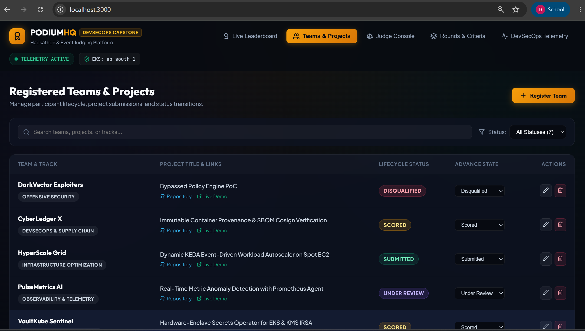

### Judge Evaluation Console
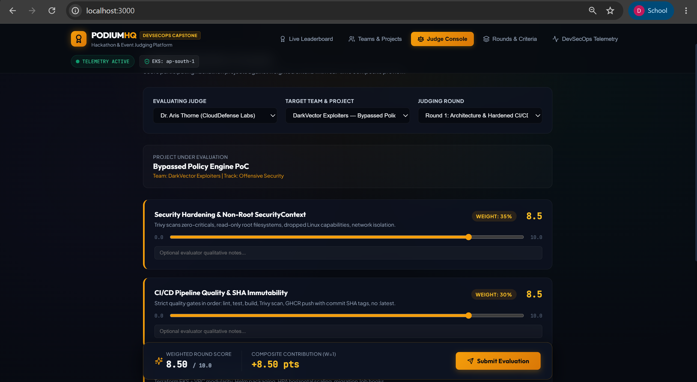

### Evaluation Structure & Criteria Weights
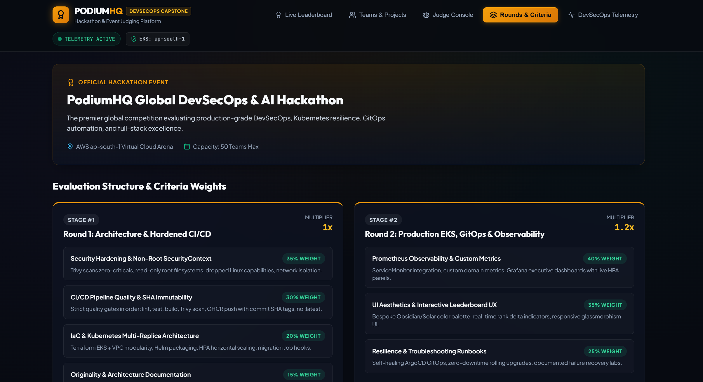

### In-App DevSecOps Platform Telemetry
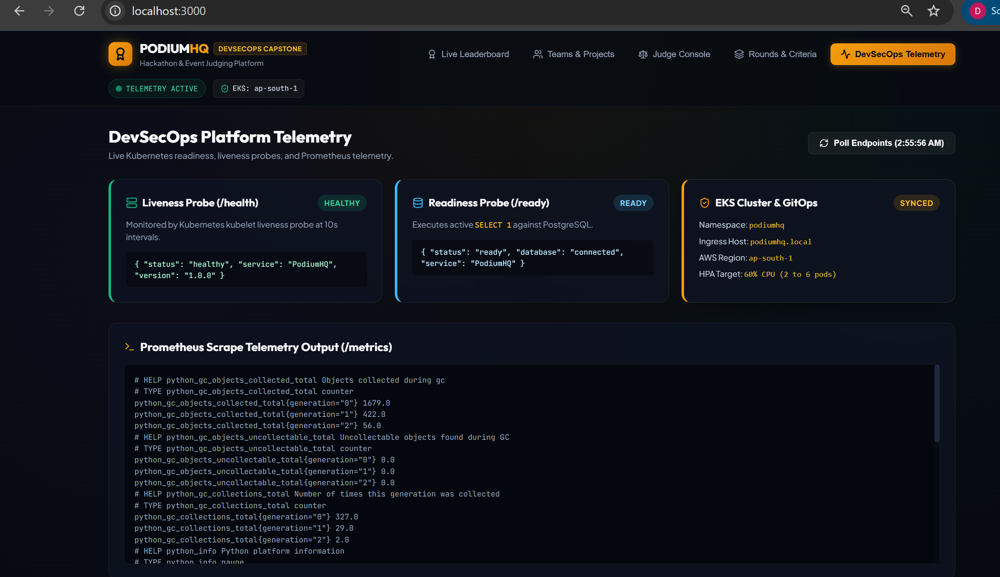

---

## 11. Backend Interactive Swagger API Documentation
**Rubric:** Module 1 — REST Endpoints & Health Contracts (10 Marks)  
**Verification:** FastAPI OpenAPI documentation exposing RESTful CRUD endpoints across events, teams, judges, rounds, scores, and health probes (`/health`, `/ready`, `/metrics`).

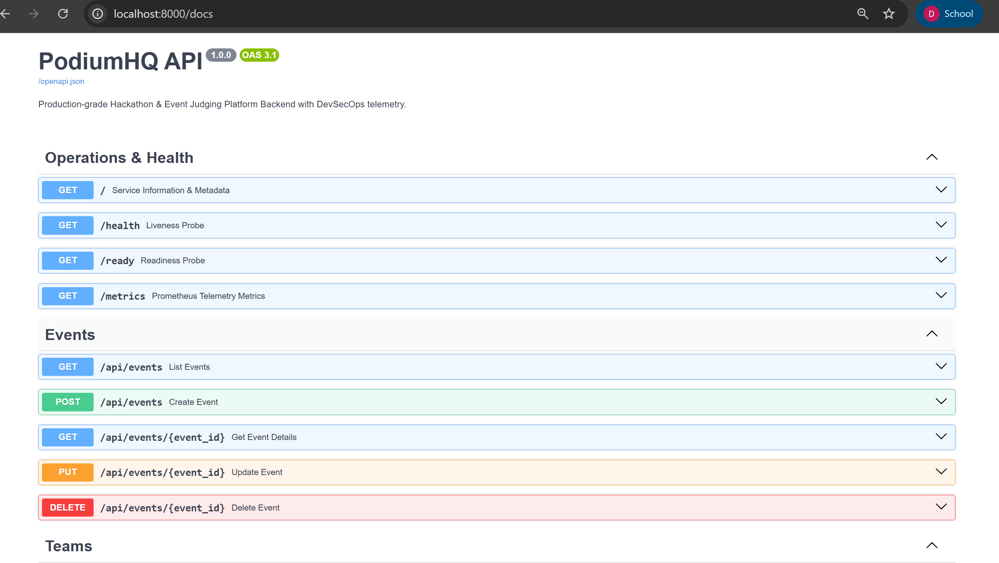
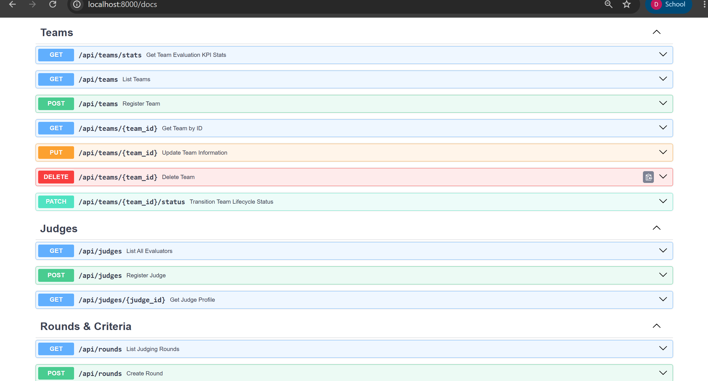
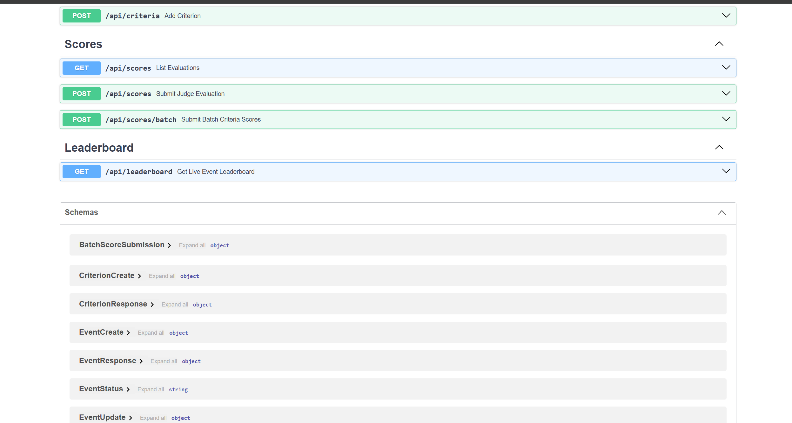
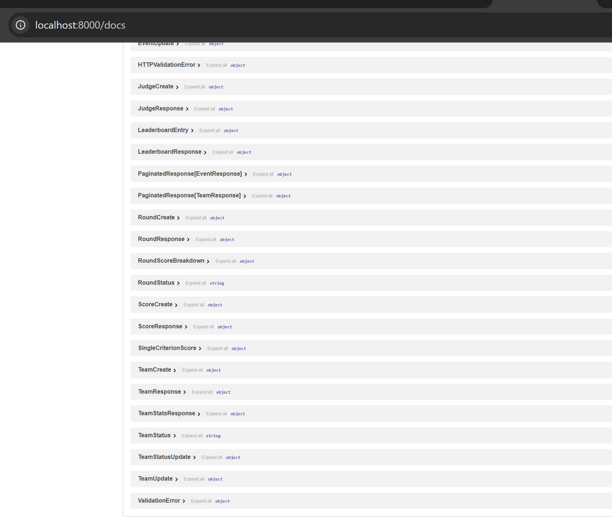

---

## 12. Prometheus,grafana Metrics Telemetry Stream
**Rubric:** Module 9 — Observability & Telemetry (10 Marks)  
**Verification:** Raw Prometheus text exposition endpoint (`/metrics`) streaming real-time HTTP metrics, status code counts, latency histograms, and custom domain gauges.

```powershell
curl.exe -s http://localhost:8000/metrics
```

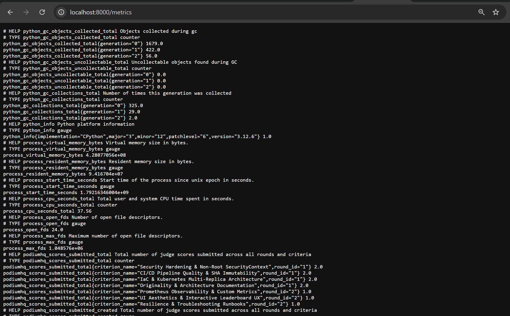


---

## 13. GitHub Container Registry (GHCR) Packages
**Rubric:** Module 5 — Container Registry Publishing & Immutability (15 Marks)  
**Verification:** Production container images published to GHCR tagged with immutable Git commit SHAs (never `:latest`).

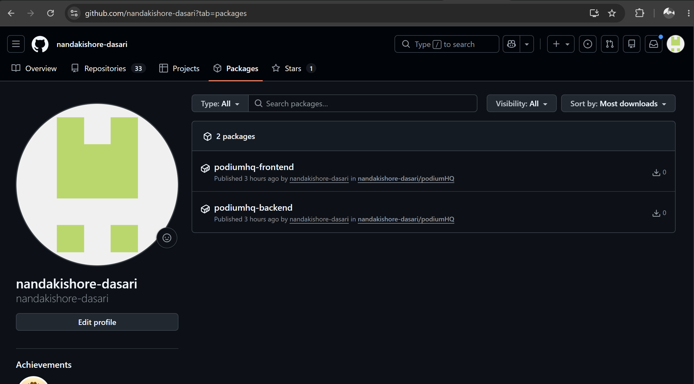

---
*Verified and Cataloged for PodiumHQ DevSecOps Capstone Evaluation*
